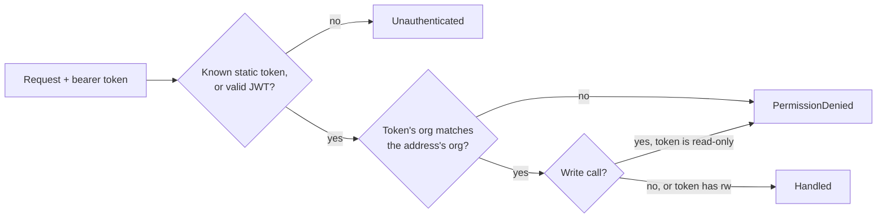

Priompt controls access with bearer tokens, each scoped to one org or to all of them, and each either read-only or read-write. Knowing how the server checks a token tells you which credential to give each person, agent, and CI job.

## Orgs

An **org** is the first segment of a prompt address: `acme` in `priompt://acme/support/agent`. There's no org object to create. An org exists once a prompt is published under it. The org is the only access boundary: a token scoped to `acme` reaches every prompt under `priompt://acme/` and nothing else. Priompt has no per-prompt or per-folder rules.

A token with no org is an **admin** token. It reaches every org.

## Credentials

The server accepts three kinds of bearer token, and they can all run on one server at once. Clients send the token in the `authorization: Bearer <token>` header.

| Credential | Configured with | Org | Write | Expires |
| --- | --- | --- | --- | --- |
| Admin environment token | `PRIOMPT_TOKEN` on the server | All orgs | Yes | Never |
| Tokens file entry | `-tokens-file`, one `token [org] [expiry] [rw]` line each | The line's org, or all orgs if none | Only with `rw` | At the line's date, if any |
| `priompt-auth` JWT | `-auth-jwks-url` | The JWT's `org` claim, or all orgs if empty | When the `rw` claim is true | 15 minutes by default |

- **Tokens file**: the fields after the token are matched by keyword, so their order doesn't matter. Write access is opt-in. Tokens are compared in constant time.
- **JWT**: a short-lived token signed by `priompt-auth` with Ed25519. `priompt-auth` issues one for a service-account secret or a single sign-on (SSO) login. The server checks the signature itself with the public key it fetched from `priompt-auth`, so `priompt-auth` isn't on the request path. See [Set up SSO and service accounts](/guides/sso).

**Mutual TLS** (mTLS) is a different layer. With `-client-ca` set, the server refuses any connection whose client certificate isn't signed by that CA, before it reads a token. A certificate carries no org or write flag, so combine mTLS with tokens.

:::danger No credentials means no access control
A server started with no `PRIOMPT_TOKEN`, no tokens file, and no `-auth-jwks-url` accepts every request with full admin access. This includes a server that requires mTLS: any client with a valid certificate can read and write every org. Use that mode only for local development.
:::

## How a request is checked

The diagram shows the checks the server applies to every call, in order:



The server tries the static tokens first, then the JWT check. A token that matches neither, an expired JWT, or a bad signature all get the same `invalid or missing token` reply, so a caller can't learn why. An expired tokens-file entry gets `token expired`.

Calls split into reads and writes:

- **Reads** (any valid token in scope): `GetPrompt`, `ListPrompts`, `DiffPrompt`, `History`, `DiffCommits`.
- **Writes** (token in scope with write access): `PublishPrompt`, `CreateBranch`, `MergeBranch`, `SetBranch`.

## Listings

`ListPrompts` takes an address prefix rather than an address, and a plain string prefix doesn't respect org boundaries: `priompt://ac` matches both `acme` and `acmecorp`. So for a scoped token, the prefix must be exactly `priompt://acme` or start with `priompt://acme/`. An empty prefix, which means "everything", is denied. The server also filters the results by org.

## Worked example

This tokens file defines four credentials:

```text title="tokens.txt"
admin-rw                    rw
acme-read      acme
acme-author    acme         rw
acme-expired   acme   2020-01-01 rw
```

Each call ran against a server with this file and prompts under both `acme` and `acmecorp`:

| Token | Call | Result |
| --- | --- | --- |
| none | `list` | `Unauthenticated desc = invalid or missing token` |
| `admin-rw` | `publish` to `priompt://acmecorp/…` | Published. |
| `acme-read` | `list -prefix priompt://acme/` | Lists only `priompt://acme/…` prompts. |
| `acme-read` | `list` | `PermissionDenied desc = token not authorized for prefix ""` |
| `acme-read` | `list -prefix priompt://ac` | `PermissionDenied desc = token not authorized for prefix "priompt://ac"` |
| `acme-read` | `publish` to `priompt://acme/…` | `PermissionDenied desc = token is read-only` |
| `acme-author` | `publish` to `priompt://acmecorp/…` | `PermissionDenied desc = token not authorized for org "acmecorp"` |
| `acme-expired` | `list -prefix priompt://acme/` | `Unauthenticated desc = token expired` |

## Authorship and audit

Each commit records an **author**, taken from the caller's identity:

- A JWT records its subject, such as `ci-bot`.
- A scoped tokens-file entry records its org, such as `acme`.
- An admin token, or a server with no credentials, records `anonymous`.

Static tokens have no name, so use `priompt-auth` JWTs when you need to know who made each change. The server also writes an audit log line for every call, as JSON with the `method`, `org`, `uri`, status `code`, and duration in `ms`. It records the caller's org, empty for admin, but not the JWT subject.

The live updates broker has its own token, separate from these credentials. See [Live updates](./live-updates.md).

## Related

- [Set up SSO and service accounts](/guides/sso): issue JWTs with `priompt-auth`.
- [Security](/operations/security): tokens file, TLS, and mTLS setup.
- [Production checklist](/operations/production-checklist): lock a server down before you expose it.
- [priompt-auth](/reference/priompt-auth): flags and JWT claims.
- [Glossary](/reference/glossary)
