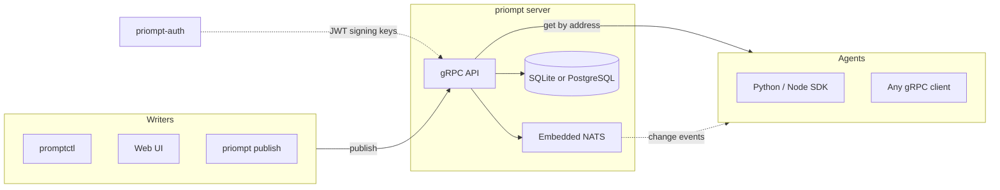
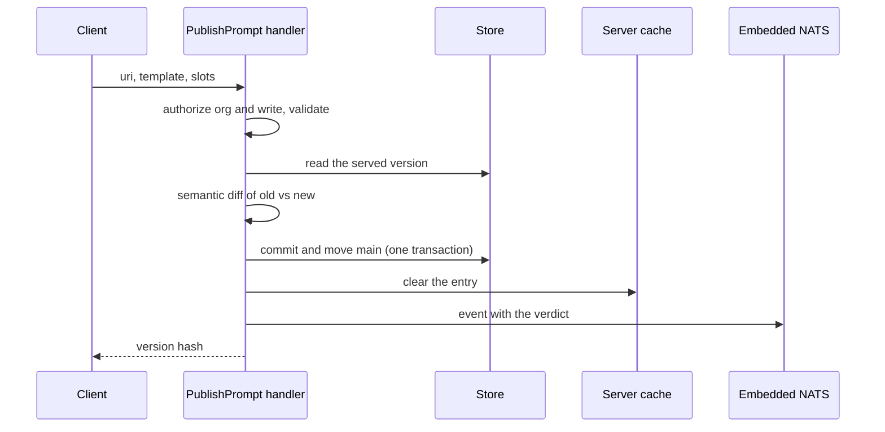

Priompt is a single server binary that stores prompts, serves them to agents over gRPC, and pushes change notifications when they change. This page names each component, follows a request through the server, and lists the ports involved.

## Components

You need only the server. Everything else is optional.

| Component | What it does |
| --- | --- |
| `priompt` | The server. It validates, versions, stores, and serves prompts over gRPC, runs the semantic diff, and embeds a NATS broker for live updates. The same binary is also the operations CLI. |
| `promptctl` | The authoring tool. Prompts live as files in a git repo and are validated and diffed on your machine before you publish them. |
| `priompt-auth` | An optional token service. It exchanges a single sign-on login or a service-account secret for a short-lived JWT that the server verifies offline. |
| Python and JavaScript SDKs | Client libraries for agents: get, diff, publish, and subscribe. |
| Web UI | A browser app for browsing prompts, history, and verdicts, and for editing prompts. |
| `proto` module | The shared contract: the gRPC API, JWT claims, validation rules, and the semantic diff engine. |
| `db-adapters` module | The storage engine: SQLite or PostgreSQL, with optional encryption at rest. |

The diagram shows how the parts connect: writers publish to the server, agents read from it, and the broker pushes changes back to agents.

The web UI isn't a gRPC client in the browser. Its own server side calls the Priompt server over gRPC, so nothing gRPC runs in the browser.

## Request flow

Every gRPC call passes through the same chain of steps, in this order:

1. **TLS**, when configured. With mutual TLS on, a client without a trusted certificate is refused here, before any other step.
2. **Metrics**: records the call's outcome and latency.
3. **Authentication**: turns the bearer token into an identity (an org scope and a write flag). With no tokens configured, every call passes.
4. **Audit log**: writes one JSON line per call with the method, org, address, and status code.
5. **Rate limit**: when enabled, limits requests per second per org.
6. **Handler**: checks the caller's org against the address, and the write flag for writes, then does the work.

A read of the served HEAD then goes: server cache, then the store on a miss, then validation, then the response. Validation runs before the result is cached, so the cache never holds an invalid prompt.

A publish to `main` does more work in the handler, shown here:

If clearing the cache fails, the call returns `UNAVAILABLE` even though the commit is stored, so the caller retries. A failed notification doesn't fail the call. See [Versioning](./versioning.md) and [Live updates](./live-updates.md).

## Storage and caching

The store keeps three things per prompt: every commit, the branch pointers, and a copy of the served HEAD for fast reads. A commit that moves `main` updates that copy in the same transaction. SQLite (a file, `priompt.db` by default) suits one node. PostgreSQL suits several nodes that share one database.

With `PRIOMPT_ENCRYPTION_KEY` set, templates and slots are encrypted with AES-256-GCM before they reach the database or the Redis cache. Version hashes stay readable.

There are two cache layers. The server cache holds served HEADs for 30 seconds by default, in process or in a shared Redis. The Python SDK can also cache inside the agent, which is off by default. See [Caching](/operations/caching).

## Ports

| Port | Flag | Serves |
| --- | --- | --- |
| `8443` | `-addr` | The gRPC API. Every client and the web UI connect here. |
| `4222` | `-nats-addr` | The embedded NATS broker, bound to `127.0.0.1` by default. Agents subscribe here. |
| `2112` | `-metrics-addr` | Prometheus `/metrics`. |
| none by default | `-nats-cluster-addr` | NATS cluster routes between server nodes. |
| `8444` | `priompt-auth -addr` | The token service: `/token` and `/jwks`. |

The server fetches signing keys from `priompt-auth` when it first sees a key ID, then verifies JWTs on its own. If `priompt-auth` is down, tokens it already issued keep working until they expire.

## Design choices

- **One binary**: the broker and the default embedder run inside the server, so a first install needs no other service.
- **Offline by default**: with no embedding endpoint configured, the semantic diff uses a built-in lexical embedder, and nothing leaves the host.
- **Validate twice**: prompts are checked when written and again when served. See [Prompts and addresses](./prompts.md).
- **Push plus a TTL**: notifications are fast but best effort. The cache TTL bounds how stale any agent can get.

## Related

- [Prompts and addresses](./prompts.md): what the server stores.
- [Orgs, tokens, and access](./access-control.md): the authentication and authorization steps in detail.
- [Server configuration](/reference/configuration): every flag and environment variable.
- [Scale to multiple nodes](/operations/scaling): PostgreSQL, Redis, and clustered brokers.
- [Glossary](/reference/glossary)
