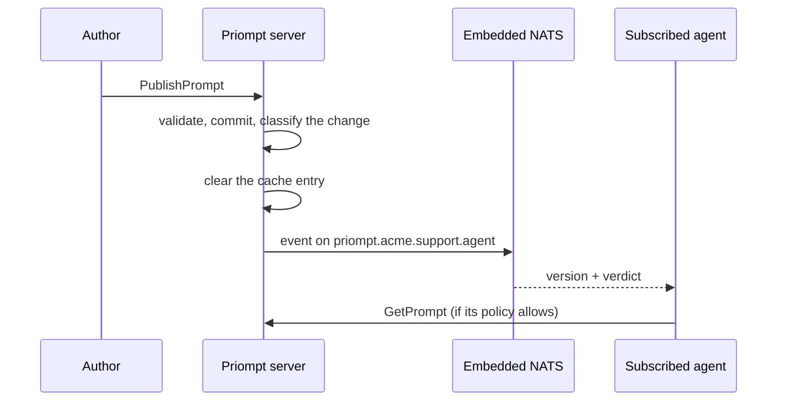

**Live updates** are notifications that Priompt pushes to subscribed agents whenever the served version of a prompt changes. They let an agent pick up a fixed prompt within moments instead of at its next restart, and decide from the attached verdict whether to reload on its own.

## Broker and subjects

The server runs an embedded **NATS** broker, an open-source message broker, inside the same process, so Priompt stays a single binary. It listens on `127.0.0.1:4222` by default. `-nats-addr ""` turns live updates off.

Each prompt address maps to a NATS **subject**, the channel a subscriber listens on. The server replaces the scheme with `priompt.` and each `/` with `.`. Inside each segment, every byte other than a letter, a digit, `_`, or `-` is percent-encoded, so two addresses never share a subject:

```text
priompt://acme/support/agent  →  priompt.acme.support.agent
priompt://acme.corp/x/a.b     →  priompt.acme%2Ecorp.x.a%2Eb
```

The SDKs compute the subject for you. Releases before priompt v0.7.3, `priompt-sdk` 0.7.1, and `@priompt/client` 0.1.1 didn't encode segments, so upgrade the server and the SDKs together if your addresses contain such characters.

The diagram shows what happens when an author publishes a new version to `main`:



## Events

An event is a small JSON object:

- **`version`**: the full version hash of the new served content.
- **`classification`**: the [semantic diff](./semantic-diff.md) verdict for the change from the old served version: `structural`, `localized tweak`, `minor edit`, or `new` for a prompt's first version. The field is left out when there's no verdict.

These are real events from two publishes, as received on the broker:

```text
priompt.acme.support.agent {"version":"e84e381192a146bc1f90062cb34b4fb363d82a8f213f916d6642a331d04061f3","classification":"new"}
priompt.acme.support.agent {"version":"d047afb8b8d1d9a75446c61e6f0ba34628d832cc8e5408a99f9e0d5f8cdb5cf8"}
```

The second event has no verdict because the server couldn't reach its embedding endpoint. The server still publishes the change, and its log explains the gap with a line that starts `classify: semantic verdict unavailable, notifying without one:` followed by the endpoint's error.

Only changes to the served HEAD send events:

| Write | Event |
| --- | --- |
| Publish new content to `main` | Yes, with the verdict, or `new` for a first version. |
| Publish the content `main` already serves | No. |
| Publish to another branch | No. |
| Roll back with `SetBranch` on `main` | Yes, with the verdict of the change from the old served version. |
| Merge into `main` that changes the served content | Yes, with the verdict. Since v0.7.3. |
| `priompt put` or `priompt import` | No. |

## Verdict policy

The verdict lets each agent choose a **reload policy**: which verdicts it reloads on its own, and which it holds for a person to review. The policy belongs to the agent, not the server. Two rules apply whatever you choose:

- **Treat a missing verdict as unchecked, not safe.** An empty verdict means the server couldn't classify the change, for example because its embedding endpoint is down. Hold it like a `structural` change.
- **Re-fetch instead of trusting the event.** Treat the event as "something changed" and read the new version over the authenticated gRPC channel.

A verdict measures how far a change spreads, not how risky it is. Changing "offer a refund when reasonable" to "never offer a refund" is a `localized tweak`. For prompts that govern refunds or safety rules, hold every change and use the verdict only to decide how urgently to ask for review. [Hot-reload prompts safely](/guides/hot-reload) has the policy code for each SDK.

## Consistency model

Push is best effort. The broker doesn't store events, so an agent that's disconnected when a change lands never receives that event. The client cache TTL is the convergence guarantee instead: every agent sees the new version on its first read after its cached copy expires.

Each server node embeds its own broker. With more than one node, cluster the brokers, or agents connected to one node miss changes published on another. See [Scale to multiple nodes](/operations/scaling).

:::warning Events are a security boundary
Events name every prompt that changes and carry the verdict agents act on. An open broker discloses every org's prompt names and lets anyone forge an event. The server refuses to bind NATS to a non-loopback address without `-nats-token`, which is the server's own full-rights credential: keep it off agents. When API authentication is also on, each agent connects with its own API token, as in `nats://<api-token>@prompts.example.com:4222`, and can only subscribe to its own org's prompts. An admin token can subscribe to every org. See [Security](/operations/security).
:::

## Related

- [Hot-reload prompts safely](/guides/hot-reload): subscribe and apply a reload policy from Python or Node.
- [Semantic diff](./semantic-diff.md): how the verdict is computed.
- [Security](/operations/security): protect the broker with a token.
- [Scale to multiple nodes](/operations/scaling): cluster the brokers.
- [priompt CLI](/reference/cli): `priompt watch` prints each event from a shell.
