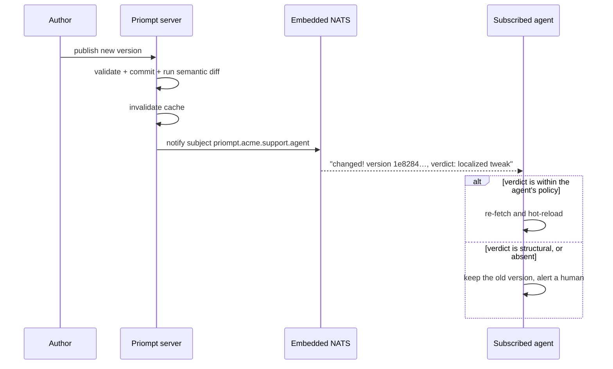

# Live updates (pub/sub)

The server embeds a **NATS** broker in-process, so it's still a single binary. `PublishPrompt` stores the new version *and* pushes a notification to every subscriber:



## Notifications carry the verdict

Each event includes the [semantic diff](./semantic-diff.md) classification: `structural`, `localized tweak`, `minor edit`, or `new`. The server already computed it on publish, so an agent can decide what to do without a second round trip:

```python
client = PromptClient(host="…:8443", cache_ttl=30, nats_url="nats://<nats-token>@…:4222")

# Which verdicts this agent acts on by itself. Everything else waits for a human,
# including an EMPTY verdict: the server couldn't classify the change (a
# misconfigured embedding endpoint, say) and published anyway.
# "" doesn't mean "safe". It means nobody checked.
AUTO_RELOAD = {"minor edit", "localized tweak", "new"}

def on_change(version, classification):
    if classification in AUTO_RELOAD:
        reload(version)
    else:
        alert_a_human(version)

client.subscribe("priompt://acme/support/agent", on_change)
```

Where you draw that line is your policy. The verdict doesn't decide it for you: a `localized tweak` can still be a policy reversal. For an agent whose prompt governs refunds or safety rules, it's reasonable to hold *everything* and let the verdict decide only how loudly to page someone.

Build these two habits in, whatever policy you choose:

- **Re-fetch rather than trusting the payload.** Treat the event as "something changed" and read the new version over the authenticated gRPC channel.
- **Fail closed on an empty verdict.** It looks like a quiet stream of harmless edits while the safety check simply isn't running.

From a shell, `priompt watch` prints the verdict. Its `-exec` hook receives `PRIOMPT_VERSION` and `PRIOMPT_CLASS`:

```sh
priompt watch -uri priompt://acme/support/agent -exec './reload.sh'
```

## Consistency model

Push is best-effort, so a network blip can drop an event. The **client cache TTL is the convergence guarantee**. The new version is stored durably either way, and subscribers converge on their next fetch.

## Securing the broker

Change events name the prompt (and therefore the org), carry the version hash, and carry the verdict that agents gate auto-reload on. An open broker would disclose every tenant's namespace and let anyone forge an event that agents act on.

- Set `-nats-token` (or `PRIOMPT_NATS_TOKEN`) whenever NATS is reachable off-loopback. The server **refuses** to bind a non-loopback address without one.
- Clients pass it in the URL: `nats://<token>@host:4222`.
- `-nats-addr ""` disables pub/sub entirely.

Running more than one node? Each node embeds its own broker, so you need to cluster them. See [Scaling](../operations/scaling.md#nats-across-nodes).
