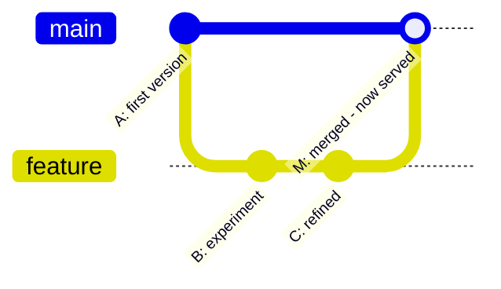
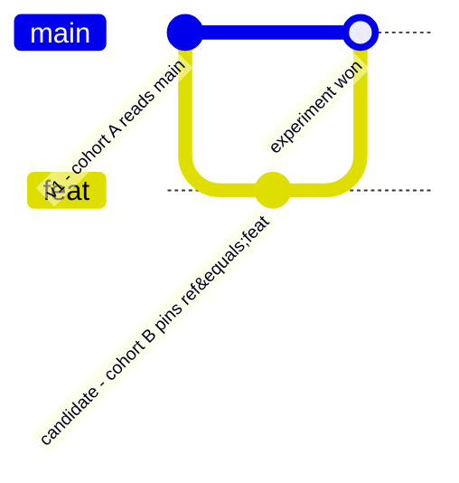

# Versioning: commits, branches, rollback

Every prompt has its own history, just like a file in Git:

- Each published change is a **commit**, with an author, a message, and a timestamp.
- A **branch** is a named line of work.
- **`main` is what agents are served**: the "served HEAD".



Work published to a `feature` branch is recorded but **invisible to agents** until it's merged into `main`. A commit's identity covers both its content and its lineage, so reverting to old content creates a new commit rather than colliding with the original.

## A typical flow

```sh
# publish onto main (the default): moves the served HEAD and notifies subscribers
priompt publish -uri priompt://acme/support/agent -file v1.txt -slot name
```

Branch, merge, history, and rollback are gRPC calls. Use the SDKs, generated stubs, or any gRPC client:

```text
CreateBranch  uri, name="feature", from="main"
PublishPrompt uri, template=…, branch="feature"   # served HEAD unchanged
MergeBranch   uri, into="main", from="feature"    # served HEAD now = feature content
History       uri, branch="main"                  # the commit log, newest first
DiffCommits   uri, from_hash, to_hash             # semantic diff of any two commits
```

## Pinning

Agents don't have to follow the latest version. `GetPrompt(uri, ref)` fetches a specific branch tip or commit, so an agent can **pin** a version and upgrade deliberately. The response carries the `commit_hash` to pin to.

```python
client.get("priompt://acme/support/agent", ref="1e8284f35650")
```

## Rollback

`SetBranch(uri, "main", <old-commit>)` points `main` at an earlier commit, which is an instant, atomic **rollback**. Every reader of HEAD gets the old version immediately: the cache is invalidated and subscribers are notified. Nothing is deleted, because a rollback only moves a pointer.

## Behavior you can rely on

- **Concurrent publishes to one prompt are safe.** Advancing a branch is a compare-and-swap against the commit the writer read. If the branch moved underneath a writer, that writer gets `ABORTED` and should re-read and retry. A publish is never reported as successful and then silently dropped.
- **A publish that can't clear the cache fails.** The change is already durable, but the RPC returns `UNAVAILABLE` and takes effect on retry. The alternative would be every node serving the old version while the caller believes the change is live. Rollback behaves the same way.
- **Publishing to a non-`main` branch** records a commit, but doesn't change the served HEAD, invalidate the cache, or notify subscribers.
- **Merging** records a two-parent merge commit. Merge content is taken from the source branch ("take theirs"). Three-way content auto-merge isn't implemented yet.
- **History** walks the first-parent chain (the mainline), newest first.

## Example: A/B test a prompt



Publish the candidate to branch `feat` and point cohort B at `get(uri, ref="feat")` while cohort A stays on `main`. `MergeBranch` ships the winner, and `SetBranch` reverts it.
