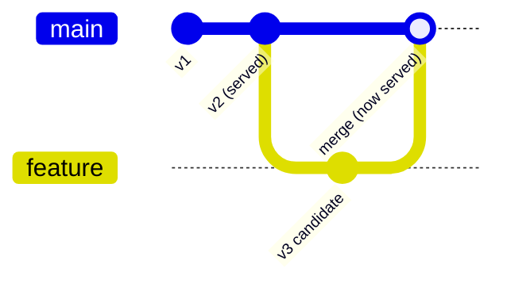

Every prompt in Priompt has its own commit history, like a file in Git. Knowing how commits, branches, and the served HEAD relate tells you exactly which version an agent receives and how to change it safely.

## Commits

A **commit** is one recorded version of one prompt: its content, its parent commit, an author, an optional message, and a timestamp. Every publish and every merge adds a commit. Creating a branch or moving one doesn't.

The **commit hash** is a SHA-256 over the prompt's address, its version hash, its parents, the author, and the message. Two consequences follow:

- Restoring old content creates a new commit. Publishing the first version's text again gives a new commit hash with the original [version hash](./prompts.md#version-hash).
- Identical content in two prompts still gives two different commits, because the address is part of the hash.

The **author** is the caller's identity: the subject of a `priompt-auth` JWT, or else the token's org, or else `anonymous`. See [Orgs, tokens, and access](./access-control.md).

## Branches and the served HEAD

A **branch** is a named pointer to a commit of one prompt. Every prompt starts with `main`. The **served HEAD** is the commit that `main` points at: the version that `GetPrompt` returns without a ref, that the server caches, and that subscribers hear about.

The diagram shows a candidate developed on a branch, then merged into `main`, which changes what agents receive:



- **Publishing** without a branch writes to `main`. Publishing to another branch records a commit there and leaves the served HEAD alone.
- **CreateBranch** points a new branch at another branch's tip, `main` by default. Publishing to a branch name that doesn't exist yet starts a new history with no parent instead.
- **MergeBranch** records a commit with two parents on the target branch, `main` by default. The merged content is the source branch's tip, taken as is. Priompt doesn't do a three-way content merge.
- **History** lists a branch's first-parent chain, newest first, like `git log --first-parent`.

Branches belong to one prompt. Each RPC takes a single `uri`, and there's no call that lists a prompt's branches.

## Pinning and refs

A **ref** names a version to read: a branch name, or a full 64-character commit hash. `GetPrompt` with a ref returns that version and its `commit_hash`, so an agent can **pin** to it and upgrade when you decide. Short hashes aren't accepted, and a commit that belongs to another prompt isn't found:

```text
ERROR:
  Code: NotFound
  Message: ref "2c5aa5eb7609" not found for "priompt://acme/support/agent"
```

Pinned reads skip the server cache and are validated like any other read.

## Rollback

`SetBranch` moves a branch pointer to an existing commit of the same prompt. On `main`, that's a **rollback**: the served HEAD changes at once, the cache entry is cleared, and subscribers get a notification. Nothing is deleted. The commits you rolled past leave `main`'s history, but you can still read them by commit hash.

## Guarantees

- **Concurrent writes don't get lost**: advancing a branch is a compare-and-swap against the tip the writer read. If another write moved the branch first, the loser gets `ABORTED` and should re-read and retry.
- **Republishing the same content is a no-op**: publishing the content `main` already serves, or the content at another branch's tip, records no commit and sends no notification. The CLI prints `unchanged`.
- **A write that can't clear the cache fails**: publish, merge into `main`, and rollback return `UNAVAILABLE` if the cache can't be cleared. The change is already stored. Retry it so every node serves the new version.
- **Branch work stays invisible**: a publish to another branch doesn't change the served HEAD, clear the cache, or notify anyone.
- **Every write is validated and committed**: `priompt put` and `priompt import` validate each prompt and commit it to `main`, with the author `priompt` and the message `put` or `import`. Identical content is a no-op. They write to the database directly, so they don't send change events or clear a running server's cache.

:::note
In v0.7.2 and earlier, a merge into `main` didn't notify subscribers, republishing identical content to another branch recorded a new commit each time, and `put` and `import` wrote no commit and skipped validation.
:::

## Worked example

This sequence ran against one prompt, `priompt://acme/support/agent`. The table shows the first 12 characters of the version hash that each branch points at after each step.

| Step | Action | `main` serves | `feature` |
| --- | --- | --- | --- |
| 1 | Publish v1 | `e84e381192a1` | none |
| 2 | Publish v2, a reworded greeting | `d047afb8b8d1` | none |
| 3 | Create branch `feature` from `main` | `d047afb8b8d1` | `d047afb8b8d1` |
| 4 | Publish v3 to `feature`, a refund rule change | `d047afb8b8d1` | `91b8599e74bd` |
| 5 | Merge `feature` into `main` | `91b8599e74bd` | `91b8599e74bd` |
| 6 | Set `main` back to the step 2 commit | `d047afb8b8d1` | `91b8599e74bd` |

Agents reading the served HEAD got v3 only between steps 5 and 6. An agent pinned to `ref="feature"` got v3 from step 4 on.

## Related

- [Branch, pin, and roll back a prompt](/guides/branch-pin-rollback): run these steps yourself.
- [A/B test a prompt](/guides/ab-test): serve a branch to part of your traffic.
- [Live updates](./live-updates.md): which writes notify subscribers.
- [gRPC API](/reference/grpc-api): every versioning RPC and its fields.
- [Glossary](/reference/glossary)
