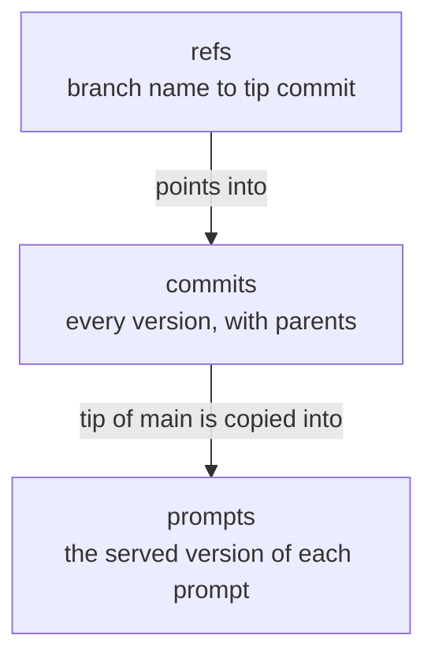

`github.com/priompt/db-adapters` is the storage engine: the schema, every query, the migrations, and encryption at rest. The server imports it, and so can any Go program that needs the data without a server. This page describes its API and schema, and how to add a database backend or a migration.

## API

`Open` picks the backend from the DSN and applies pending migrations:

```go
import store "github.com/priompt/db-adapters"

st, err := store.Open("prompts.db")                   // a file path: SQLite
st, err = store.Open("postgres://user:pw@host/db")    // a postgres:// DSN: PostgreSQL
```

| Group | Methods |
| --- | --- |
| Served content | `Get`, `Put`, `List`, `Dump` |
| History | `Commit`, `Branch`, `Merge`, `Log`, `Resolve`, `SetBranch`, `GetCommit` |
| Backup | `DumpCommits`, `DumpRefs`, `PutCommit`, `PutRef`, `CountCommits` |
| Helpers | `Hash` (version hash), `CommitHash`, `SchemaVersion`, `NewSealer` |

Errors to check with `errors.Is`: `ErrNotFound`, `ErrBranchNotFound`, `ErrAlreadyExists`, and `ErrConflict` (the branch moved during a write). The server maps each one to a gRPC code; see [Errors](../reference/errors.md).

When `PRIOMPT_ENCRYPTION_KEY` is set, `Open` encrypts the `template` and `slots` columns with AES-256-GCM. Rows written before the key was set stay readable, so encryption can be turned on without a migration. Hashes are computed over the plaintext, so lookups and deduplication work either way.

## Schema

The engine keeps three tables. A commit on `main` writes all three in one transaction, so the served content always matches the history.



```sql title="Migrations 1 to 4"
CREATE TABLE IF NOT EXISTS prompts(
  uri TEXT PRIMARY KEY, template TEXT NOT NULL,
  slots TEXT NOT NULL,                -- JSON array
  version_hash TEXT NOT NULL);
CREATE TABLE IF NOT EXISTS commits(
  hash TEXT PRIMARY KEY, uri TEXT NOT NULL,
  template TEXT NOT NULL, slots TEXT NOT NULL, version_hash TEXT NOT NULL,
  parent TEXT, parent2 TEXT,          -- parent2 only on merge commits
  author TEXT NOT NULL, message TEXT NOT NULL, created_at TEXT NOT NULL);
CREATE INDEX IF NOT EXISTS commits_uri ON commits(uri);
CREATE TABLE IF NOT EXISTS refs(
  uri TEXT NOT NULL, branch TEXT NOT NULL, commit_hash TEXT NOT NULL,
  PRIMARY KEY(uri, branch));
```

A fifth table, `schema_version`, records how many migrations ran. `priompt migrate` prints that number.

## How backends plug in

All SQL is written once, with `?` placeholders, and runs on every backend. A backend, called a dialect, supplies only what differs:

```go title="dialect.go"
type dialect struct {
	driver   string                // database/sql driver name
	match    func(dsn string) bool // does this DSN belong to this backend?
	rebind   func(q string) string // ?-style placeholders to native style
	dsn      func(dsn string) string // optional: rewrite the DSN before it reaches the driver
	maxConns int                   // optional: cap the connection pool; 0 = unlimited
}
```

`Open` tries the dialects in the order of the `dialects` list and uses the first whose `match` returns `true`. SQLite comes last and matches everything, so any DSN that no other dialect claims is a SQLite file path. SQLite also uses `dsn` to add its WAL and busy-timeout settings, and `maxConns: 1` because it serializes writes.

## Add a database

To add a backend:

1. Create a file named after the backend, with a `dialect` variable. If the backend needs a new driver, blank-import it there, as `postgres.go` does.
2. Add the variable to `dialects` in `dialect.go`, before `sqlite`.
3. Check the queries the backend must support: `ON CONFLICT ... DO UPDATE` upserts, `ON CONFLICT DO NOTHING`, and `WITH RECURSIVE`. An engine without `ON CONFLICT` (MySQL uses `ON DUPLICATE KEY`) needs a per-dialect upsert clause first.
4. Run `go test ./...` and the end-to-end runbook against a real instance.

For example, this file adds CockroachDB, which speaks the PostgreSQL wire protocol, so it reuses the PostgreSQL driver and placeholders:

```go title="cockroach.go"
package priomptdb

import "strings"

// cockroach claims cockroachdb:// DSNs. CockroachDB speaks the PostgreSQL
// wire protocol, so it reuses the pgx driver and $1-style placeholders, and
// only rewrites the scheme to one pgx accepts.
var cockroach = dialect{
	driver: "pgx",
	match:  func(dsn string) bool { return strings.HasPrefix(dsn, "cockroachdb://") },
	rebind: postgres.rebind,
	dsn: func(dsn string) string {
		return "postgresql://" + strings.TrimPrefix(dsn, "cockroachdb://")
	},
}
```

```go title="dialect.go"
var dialects = []dialect{postgres, cockroach, sqlite}
```

With these two changes the module builds and its tests pass. Running it against CockroachDB itself is step 4.

## Add a migration

Migrations are an ordered, append-only list in `store.go`. Each one runs once, in its own transaction, the next time any binary opens the database.

To change the schema:

1. Append a statement to the end of `migrations`. Never edit, remove, or reorder an existing one, or existing databases diverge from new ones.
2. Write it so it runs on every dialect, and make it safe to re-run (`IF NOT EXISTS`).
3. Run `go test ./...`, then `priompt migrate -db <copy-of-a-real-db>` to check that the version goes up by one.

## Test

The tests use SQLite in a temporary directory, so nothing needs installing:

```sh
GOWORK=off go test ./...
```

```text title="Output"
ok  	github.com/priompt/db-adapters	4.712s
```

## Next steps

- [Testing](./testing.md): the PostgreSQL and Redis suites in the runbook.
- [Storage and backups](../operations/storage.md): run the storage engine in production.
