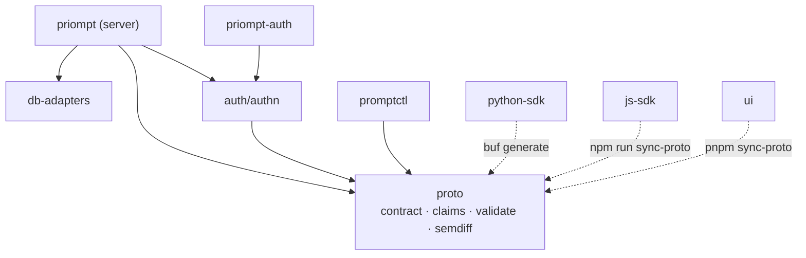

This page sets up a workspace for changing Priompt itself: every repository cloned side by side, built together with a Go workspace, and the SDKs installed from the checkout. To run Priompt rather than change it, see [Install Priompt](../installation/index.mdx).

## Prerequisites

Before you begin, make sure you have:

- **Go 1.25 or later**: from [go.dev/dl](https://go.dev/dl/).
- **git**: any recent version.
- **Python 3.9 or later**: only for the Python SDK.
- **Node 20 or later**: for the Node SDK, the web UI, and the docs site.
- **buf**: only to change the `.proto` contract. See [Change the contract](./proto.md).

## Repositories

Priompt is a family of small repositories under `github.com/priompt`:

| Repository | Ships | Language |
| --- | --- | --- |
| `priompt` | The server and the `priompt` CLI | Go |
| `proto` | Go module `github.com/priompt/proto`: the gRPC contract and stubs, the JWT claims, `validate`, and `semdiff` | Go, protobuf |
| `db-adapters` | Go module `github.com/priompt/db-adapters`: SQLite and PostgreSQL storage | Go |
| `auth` | `priompt-auth`, and the `github.com/priompt/auth/authn` package the server imports | Go |
| `cli` | `promptctl` | Go |
| `python-sdk` | The Python client, imported as `priompt_sdk` | Python |
| `js-sdk` | The Node client | JavaScript |
| `ui` | The web UI | SvelteKit |
| `priompt-dot-com` | The marketing site and these docs | Next.js, Docusaurus |

Shared code lives in one place and is imported, never copied. Every dependency points one way:



Authentication (tokens, JWTs, the tokens file, and the `Provider` interface) lives in `auth/authn`. The server keeps only authorization, in `internal/auth`, because org scoping is a rule about prompt URIs. The server imports `auth/authn` but never calls the `priompt-auth` service.

## 1. Clone the repositories

Each Go repository builds on its own against the tagged versions in its `go.mod`. To change several at once, clone them side by side:

```sh
mkdir priompt-family && cd priompt-family
for r in priompt proto db-adapters auth cli python-sdk js-sdk; do
  git clone https://github.com/priompt/$r.git
done
```

## 2. Create a Go workspace

A `go.work` file makes each Go module use your local copy of the others instead of the published version:

```sh
go work init ./priompt ./proto ./db-adapters ./auth ./cli
cat go.work
```

```text title="Output"
go 1.26.4

use (
	./auth
	./cli
	./db-adapters
	./priompt
	./proto
)
```

The `go` line shows your toolchain version. Don't commit `go.work`.

`go work init` refuses to run when a parent directory already has a `go.work`. Set `GOWORK` to a file in this directory first, for example `export GOWORK=$PWD/go.work`.

## 3. Build the binaries

```sh
(cd priompt && go build -o priompt ./cmd/priompt && ./priompt version)
(cd cli && go build -o promptctl ./cmd/promptctl)
(cd auth && go build -o priompt-auth ./cmd/priompt-auth)
```

```text title="Output"
priompt v0.7.3-0.20261017201506-7012aa66a1da (commit 7012aa66a1da43c3dc4dd7cd8951ab781f0327c0, go1.26.4)
```

A build inside a checkout reports a pseudo-version and the git commit. On Windows, add `.exe` to the output names. The server repository also has a Makefile with `make build` and `make test`.

## 4. Run the tests

With the workspace active, `go test ./...` in a repository tests it against your local copies of the others. To test a repository against its published dependencies, as CI does, turn the workspace off:

```sh
cd priompt && GOWORK=off go test ./...
```

```text title="Output"
ok  	github.com/priompt/priompt/cmd/priompt	7.176s
ok  	github.com/priompt/priompt/internal/auth	1.300s
ok  	github.com/priompt/priompt/internal/pubsub	3.288s
ok  	github.com/priompt/priompt/internal/server	6.685s
```

Every suite and what it needs is in [Testing](./testing.md).

## 5. Install the SDKs from the checkout

To install the Python SDK in a virtual environment and run its tests:

1. Create the environment and install the SDK in editable mode, with pytest:

   ```sh
   cd python-sdk
   python -m venv venv
   venv/bin/pip install -e . pytest
   ```

   On Windows, the scripts are in `venv\Scripts` instead of `venv/bin`.

2. Run the tests:

   ```sh
   venv/bin/python -m pytest -q
   ```

   ```text title="Output"
   ..............                                                           [100%]
   14 passed in 0.61s
   ```

3. For `subscribe()`, install the `nats` extra: `venv/bin/pip install -e ".[nats]"`.

Apps import it as `from priompt_sdk import PromptClient`.

To install the Node SDK and check that it loads:

```sh
cd js-sdk
npm install
node --check client.js
node -e "new (require('./client.js').PromptClient)({host:'localhost:1'}); console.log('construct-ok')"
# => construct-ok
```

Use it from another project with `npm link`, or with `require("../js-sdk/client.js")`.

## Server layout

```text
cmd/priompt/main.go                server and CLI commands
cmd/priompt/backup.go              backup and restore
internal/auth/auth.go              authorization: org scoping and the write gate
internal/server/server.go          gRPC handlers
internal/server/errors.go          storage errors to gRPC status codes
internal/server/observability.go   metrics, audit log, and rate-limit interceptors
internal/server/cache.go           in-process L2 cache
internal/server/redis_cache.go     Redis L2 cache
internal/pubsub/pubsub.go          embedded NATS broker, publisher, and subscriber
```

A `GetPrompt` request passes through the interceptors (metrics, authentication, audit log, rate limit), then `Server.GetPrompt`. It checks the org scope, reads the cache or the store, runs `validate.Prompt`, and returns the prompt.

## Seed development data

To run a server with sample prompts and commit history:

1. Start a server on a scratch database:

   ```sh
   cd priompt && ./priompt serve -db dev.db
   ```

2. In another terminal, run the seed script against it:

   ```sh
   sh seed-dev.sh localhost:8443
   ```

   The script publishes ten versions across seven prompts under `priompt://acme/`, so the history views have data.

The script ends with a `./priompt.exe list` call, which fails outside Windows after every prompt is published. Run `./priompt list -prefix priompt://acme/` to see the result.

## Docs site

The docs live in `priompt-dot-com/docs`. To build them, and for the style rules every page follows, see [Write docs](./docs.mdx).

## Next steps

- [Change the contract](./proto.md): add a field or an RPC, and regenerate every consumer.
- [Storage engine](./db-adapters.md): add a database backend or a migration.
- [Testing](./testing.md): run the unit suites and the end-to-end runbook.
