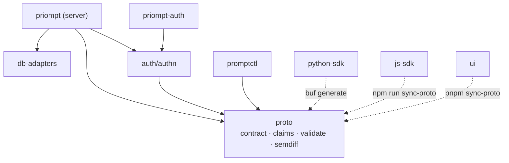

# Developing Priompt

## The repos

Priompt is a family of small repos, each doing one job:

| Repo | Ships | Language |
| --- | --- | --- |
| `priompt` | server + ops CLI | Go |
| `proto` | Go module `priomptproto`: the gRPC contract + stubs, JWT claims, `validate`, `semdiff` | Go + protobuf |
| `auth` | `priompt-auth` binary + the `priomptauth/authn` package | Go |
| `db-adapters` | Go module `priomptdb`: SQLite/Postgres storage | Go |
| `cli` | `promptctl` | Go |
| `python-sdk` | pip package `priompt-sdk` (imports as `priompt_sdk`) | Python |
| `js-sdk` | npm package | Node |
| `ui` | web front end | SvelteKit |
| `priompt-dot-com` | marketing site + these docs | Next.js + Docusaurus |

## The module graph

Every arrow points one way. Shared things live in exactly one place and are imported, never copied:



Authentication (credentials, JWT minting and verification, the tokens file, the pluggable `Provider` interface) lives entirely in `auth/authn`. The server keeps only **authorization**, in `internal/auth`, because org scoping is policy about prompt URIs. The server build-depends on `auth` but never calls the auth service at runtime.

## Setup

Clone the family side by side (see [From source](../installation/from-source.md#get-the-code)). The Go repos use `replace` directives such as `replace priomptproto => ../proto` until the modules are published.

```sh
cd priompt   && make build && make test
cd ../auth   && go build -o priompt-auth . && go test ./...
cd ../cli    && go build -o promptctl .    && go test ./...
cd ../python-sdk && python -m venv venv && venv/bin/pip install -e . pytest && venv/bin/pytest -q
cd ../js-sdk && npm install
```

## Server layout

```text
cmd/priompt/main.go                server + ops CLI
cmd/priompt/backup.go              backup / restore
internal/auth/auth.go              authorization: org scoping + write gate
internal/server/server.go          gRPC handlers
internal/server/observability.go   metrics, audit log, rate-limit interceptors
internal/server/cache.go           in-process L2 cache
internal/server/redis_cache.go     Redis L2 cache
internal/pubsub/pubsub.go          embedded NATS publisher + subscriber
```

A request flows: agent → gRPC → auth interceptor → `Server.GetPrompt` → `store.Get` → `validate.Prompt` → response.

## Dev data

```sh
cd priompt && ./priompt serve -db dev.db
sh seed-dev.sh localhost:8443     # prompts with real commit history (uses publish)
```

## This docs site

```sh
cd priompt-dot-com
pnpm install
pnpm docs:dev          # http://localhost:3000
pnpm docs:build        # static output in docs/build
```

Release names that aren't final (the Docker image, the PyPI and npm packages) live in `docs/src/vars.ts`. Pages use them through two components, available in every `.mdx` page without an import:

```mdx
Install with <Var name="pypiName" />.

<Cmd lang="sh">{`docker run -p 8443:8443 {{dockerImage}}`}</Cmd>
```

`<Cmd>` substitutes each `{{var}}` and adds a "name not final" note while a value is still a `<placeholder>`. To name the release, edit one line in `vars.ts`, or set `PRIOMPT_DOCKER_IMAGE`, `PRIOMPT_PYPI_NAME`, or `PRIOMPT_NPM_NAME` at build time.
