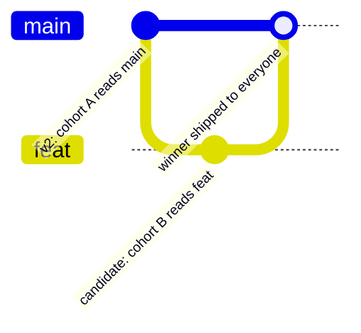

This guide runs an A/B test on a prompt: cohort A keeps the served HEAD on `main`, and cohort B reads a candidate from a branch. Priompt keeps both versions on the server, so the test needs no deploy, and shipping the winner is one call.

The diagram shows the branch layout. Cohort A reads `main` throughout, and cohort B pins the `feat` branch until the merge.



## Prerequisites

Before you begin, make sure you have:

- **A running Priompt server** with the prompt `priompt://acme/support/agent` on `main`. See the [Quickstart](../quickstart.mdx).
- **An `rw` token** for the `acme` org, if the server has authentication on, to create the branch and merge it. Agents only need a read token.
- **A client**: Python (`pip install` <Var name="pypiName" />) or Node (`npm install` <Var name="npmName" />).

## 1. Publish the candidate to a branch

To publish the candidate:

1. Create the branch `feat` from `main`, and publish the candidate to it. Follow steps 4 and 5 of [Branch, pin, and roll back a prompt](./branch-pin-rollback.mdx).

   ```text title="Output"
   feat starts at c74e161b5a01
   feat version 4137353438f2
   main serves: You are a support agent for {org}. Be concise and kind. Offer a refund when reasonable.
   ```

   Agents that read `main` still get the current version. A publish to a branch doesn't notify subscribers.

## 2. Route users to cohorts

Assign each user to a cohort with a stable hash of their ID, so the same user always sees the same version. Cohort B reads the candidate with a pinned read (`ref="feat"`). Cohort A reads the served HEAD.

<Tabs groupId="lang">
<TabItem value="py" label="Python">

```python title="ab.py"
import hashlib
from priompt_sdk import PromptClient

URI = "priompt://acme/support/agent"
CANDIDATE = "feat"  # the branch with the version under test
SHARE = 20          # percent of users who get the candidate

client = PromptClient(host="localhost:8443", cache_ttl=30)

def cohort(user_id):
    bucket = int(hashlib.sha256(user_id.encode()).hexdigest()[:8], 16) % 100
    return "B" if bucket < SHARE else "A"

def prompt_for(user_id):
    if cohort(user_id) == "B":
        return client.get(URI, ref=CANDIDATE)  # pinned read
    return client.get(URI)  # served HEAD

for user in ["ada", "grace", "alan", "edsger", "barbara", "ken"]:
    p = prompt_for(user)
    print(user, cohort(user), p.version_hash[:12])  # log this with the outcome
```

</TabItem>
<TabItem value="js" label="Node">

<Cmd lang="js" title="ab.js">{`const crypto = require("crypto");
const { PromptClient } = require("{{npmName}}");

const URI = "priompt://acme/support/agent";
const CANDIDATE = "feat"; // the branch with the version under test
const SHARE = 20; // percent of users who get the candidate

const client = new PromptClient({ host: "localhost:8443" });

function cohort(userId) {
  const hex = crypto.createHash("sha256").update(userId).digest("hex");
  return parseInt(hex.slice(0, 8), 16) % 100 < SHARE ? "B" : "A";
}

function promptFor(userId) {
  if (cohort(userId) === "B") return client.get(URI, CANDIDATE); // pinned read
  return client.get(URI); // served HEAD
}

async function main() {
  for (const user of ["ada", "grace", "alan", "edsger", "barbara", "ken"]) {
    const p = await promptFor(user);
    console.log(user, cohort(user), p.version_hash.slice(0, 12)); // log this with the outcome
  }
}
main();`}</Cmd>

</TabItem>
</Tabs>

```text title="Output"
ada A b436dfe49b72
grace A b436dfe49b72
alan B 4137353438f2
edsger B 4137353438f2
barbara A b436dfe49b72
ken A b436dfe49b72
```

Both languages compute the same cohort for the same ID. Record `version_hash` next to each outcome you measure, such as resolution rate or user rating, so you can compare the two versions.

Pinned reads skip the server cache and the Python client cache. If cohort B is large, fetch the candidate once and refresh it on a timer instead of reading it per request.

## 3. Ship the winner

To ship the candidate to everyone:

1. Merge `feat` into `main` with `MergeBranch`. See step 7 of [Branch, pin, and roll back a prompt](./branch-pin-rollback.mdx).

   ```text title="Output"
   merge commit 0cd1e53a2a7a
   main serves: You are a support agent for {org}. Ask for the order number first.
   ```

2. Run the routing code again. Both cohorts now get the candidate:

   ```text title="Output"
   ada A 4137353438f2
   grace A 4137353438f2
   alan B 4137353438f2
   edsger B 4137353438f2
   barbara A 4137353438f2
   ken A 4137353438f2
   ```

3. Set `SHARE` to `0` to end the test.

In v0.7.2, a merge doesn't send a change event. Agents that hold the old version in memory pick up the merge on their next fetch. If the shipped version misbehaves, [roll it back](./branch-pin-rollback.mdx) with `SetBranch`.

To end the test without shipping, set `SHARE` to `0`. Cohort B goes back to `main`. The branch stays on the server, because Priompt has no call to delete a branch.

## Next steps

- [Hot-reload prompts safely](./hot-reload.mdx): control what running agents do when `main` changes.
- [Use a real embedding model](./embedding-model.md): see how far the candidate's meaning moved before you test it.
- [Versioning](../concepts/versioning.md): how branches, merges, and the served HEAD relate.
