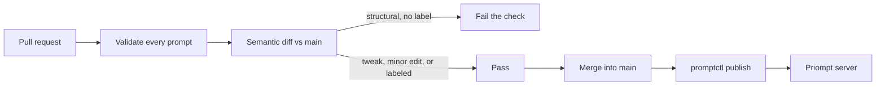

This guide adds two GitHub Actions workflows to a prompts repo. The first validates every prompt in a pull request and fails on `structural` changes until a reviewer approves them. The second publishes to your Priompt server when a change merges into `main`.

The flow is shown below.



## Prerequisites

Before you begin, make sure you have:

- **A prompts repo on GitHub** laid out for `promptctl`. See [Author prompts in git with promptctl](./promptctl.mdx).
- **A reachable Priompt server** for the publish job, with TLS.
- **An `rw` token** scoped to your org, stored as the repository secret `PRIOMPT_TOKEN`. See [Secure a server](../operations/security.md). For short-lived tokens from your identity provider, see [Set up SSO and service accounts](./sso.md).
- **The server address**, stored as the repository variable `PRIOMPT_SERVER`, for example `prompts.example.com:8443`.

## How the checks work

`promptctl` has no validate-only command. `promptctl commit` validates, but on a clean CI checkout it fails with `cannot create empty commit: clean working tree`, whatever the prompts contain. The check workflow therefore starts a throwaway `priompt` server inside the job and publishes every prompt to it. `promptctl publish` validates each file and exits with status 1 on the first invalid one.

`promptctl diff -fail-on structural` prints the diff and exits with status 1 when any prompt reads as `structural`. A prompt that doesn't exist on the base branch yet reads as `new`, so adding a prompt passes unless you also list `new`.

## 1. Install the tools

Every job installs the binaries with `go install`. `actions/setup-go` puts them on the `PATH`:

```yaml
      - uses: actions/setup-go@v5
        with:
          go-version: "1.25"
      - name: Install promptctl and priompt
        run: |
          go install github.com/priompt/cli/cmd/promptctl@v0.7.1
          go install github.com/priompt/priompt/cmd/priompt@v0.7.3
```

## 2. Validate every prompt

To validate, start a server with a temporary database, wait until it answers, and publish to it:

```yaml
      - name: Validate every prompt
        run: |
          priompt serve -addr 127.0.0.1:8443 -db "$RUNNER_TEMP/ci.db" -nats-addr "" -metrics-addr "" &
          for _ in $(seq 1 20); do priompt list -addr 127.0.0.1:8443 >/dev/null 2>&1 && break; sleep 0.5; done
          promptctl publish -server 127.0.0.1:8443
```

A bad prompt fails the step with the file and the reason:

```text title="Output"
published priompt://acme/support/agent (d4378ae17508)
2026/10/18 10:20:12 invalid acme/support/greeting.prompt: template uses doubled braces near "{{name}}\n": slots are written {name}; {{name}} is an escaped literal brace to a formatter, not a slot
```

## 3. Fail on structural changes

To gate on the verdict, diff the pull request against its base branch and fail if any prompt reads as `structural`. A reviewer who accepts the change adds the `structural-ok` label, which re-runs the check:

```yaml
      - name: Fail on structural changes
        env:
          ALLOW: ${{ contains(github.event.pull_request.labels.*.name, 'structural-ok') }}
        run: |
          if [ "$ALLOW" = "true" ]; then FAIL_ON=""; else FAIL_ON=structural; fi
          promptctl diff -fail-on "$FAIL_ON" "origin/$GITHUB_BASE_REF" || {
            echo "::error::Structural prompt change. Review it, then add the structural-ok label."
            exit 1
          }
```

For a change that flips a refund rule, the step prints the diff and fails:

```text title="Output"
## acme/support/agent.prompt
change @ new lines 4-4 (old 4-4): replace
  Signal 2 (point delta): 0.908
  Signal 3 up:   ±2=0.369 ±4=0.254 (boundary)
  Signal 3 down: ±2=0.494 (boundary)
  => structural

2026/10/19 01:03:58 diff: 1 prompt(s) match -fail-on structural: acme/support/agent.prompt (structural)
::error::Structural prompt change. Review it, then add the structural-ok label.
```

With the label, `-fail-on` is empty, so the step prints the diff and passes. `promptctl diff` exits with status 2 for a verdict name it doesn't know, which also fails the step.

The diff needs the base branch's history, so the checkout uses `fetch-depth: 0`. Without an embedding model, the verdict compares words. To compare meaning, set `PRIOMPT_EMBED_URL`, `PRIOMPT_EMBED_MODEL`, and `PRIOMPT_EMBED_KEY` on this step. See [Use a real embedding model](./embedding-model.md).

<details>
<summary>The complete check workflow</summary>

```yaml title=".github/workflows/prompts-check.yml"
name: Check prompts
on:
  pull_request:
    types: [opened, synchronize, reopened, labeled, unlabeled]
    paths: ["**.prompt"]

jobs:
  check:
    runs-on: ubuntu-latest
    steps:
      - uses: actions/checkout@v4
        with:
          fetch-depth: 0
      - uses: actions/setup-go@v5
        with:
          go-version: "1.25"
      - name: Install promptctl and priompt
        run: |
          go install github.com/priompt/cli/cmd/promptctl@v0.7.1
          go install github.com/priompt/priompt/cmd/priompt@v0.7.3
      - name: Validate every prompt
        run: |
          priompt serve -addr 127.0.0.1:8443 -db "$RUNNER_TEMP/ci.db" -nats-addr "" -metrics-addr "" &
          for _ in $(seq 1 20); do priompt list -addr 127.0.0.1:8443 >/dev/null 2>&1 && break; sleep 0.5; done
          promptctl publish -server 127.0.0.1:8443
      - name: Fail on structural changes
        env:
          ALLOW: ${{ contains(github.event.pull_request.labels.*.name, 'structural-ok') }}
        run: |
          if [ "$ALLOW" = "true" ]; then FAIL_ON=""; else FAIL_ON=structural; fi
          promptctl diff -fail-on "$FAIL_ON" "origin/$GITHUB_BASE_REF" || {
            echo "::error::Structural prompt change. Review it, then add the structural-ok label."
            exit 1
          }
```

</details>

## 4. Publish on merge

To publish when a change lands on `main`, add a second workflow. `promptctl publish` sends `PRIOMPT_TOKEN` as a bearer token. The server only stores and notifies for prompts whose content changed.

```yaml title=".github/workflows/prompts-publish.yml"
name: Publish prompts
on:
  push:
    branches: [main]
    paths: ["**.prompt"]

jobs:
  publish:
    runs-on: ubuntu-latest
    steps:
      - uses: actions/checkout@v4
      - uses: actions/setup-go@v5
        with:
          go-version: "1.25"
      - name: Install promptctl
        run: go install github.com/priompt/cli/cmd/promptctl@v0.7.1
      - name: Publish to the server
        env:
          PRIOMPT_TOKEN: ${{ secrets.PRIOMPT_TOKEN }}
        run: promptctl publish -server "${{ vars.PRIOMPT_SERVER }}" -tls
```

`-tls` without `-ca-cert` trusts the system CA roots, which works for a server with a public certificate. For a private CA, commit the CA certificate to the repo and add `-ca-cert <path>`.

`promptctl publish` publishes files one at a time and stops at the first error. The check workflow catches invalid prompts before they reach `main`, so a publish run doesn't stop halfway.

## Next steps

- [Hot-reload prompts safely](./hot-reload.mdx): decide what agents do when the publish job runs.
- [Set up SSO and service accounts](./sso.md): replace the static token with short-lived ones for `ci-bot`.
- [promptctl reference](../reference/promptctl.md): every command and flag.
