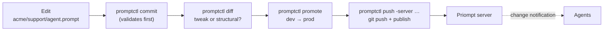

# Authoring with promptctl

`promptctl` lets prompt writers work the way developers work on code. Prompts are plain files in a git repo, every change is validated and committed, far-reaching edits get flagged *before* they ship, and one command publishes to the server.



Build it with `go build -o promptctl .` in the `cli` repo (see [From source](../installation/from-source.md#promptctl-and-priompt-auth)). Git is embedded through go-git, so you don't need a `git` binary.

## Files are prompts

- The file path becomes the URI: `acme/support/agent.prompt` → `priompt://acme/support/agent`.
- Slots are read from the template's `{placeholders}`. You don't declare them by hand.
- The first directory is the **org**, so a `.prompt` file at the repo root is rejected.

## A day in the life

```sh
git init prompts && cd prompts
mkdir -p acme/support
echo "You are a support agent for {org}. Be concise and kind." > acme/support/agent.prompt

# 1. commit: every *.prompt is validated first, and one bad file blocks the whole commit
promptctl commit -m "first prompt"

# 2. edit, then see what the edit *means*
promptctl diff                 # against HEAD
promptctl diff HEAD~1
# => localized tweak

# 3. lineage of one prompt
promptctl log acme/support/agent.prompt
# 1b23fe84 tighten policy
# f1a28af6 first prompt

# 4. ship it: git push + publish to the server in one step
promptctl push -server prompts.internal:8443
```

## Environments are branches

`promote` copies a validated prompt from one branch onto another and commits it. That makes a deliberate, recorded promotion instead of a copy-paste.

```sh
promptctl promote acme/support/agent.prompt dev staging
promptctl promote acme/support/agent.prompt staging prod
```

## In CI

```sh
promptctl commit -m "ci check"        # validation gate on every PR
promptctl diff origin/main            # inspect for `structural` and fail the build on it
promptctl push -server $PRIOMPT_HOST  # on merge, authenticated with a service-account JWT
```

Publishing is idempotent. Unchanged content is a no-op, so only real changes fire a notification. Git stays the source of truth, and the server is the live serving copy.

## Configuration

| Variable | Purpose |
| --- | --- |
| `PRIOMPT_EMBED_URL` / `_MODEL` / `_KEY` | embedding endpoint for `diff`; without one it falls back to the lexical embedder |
| `PRIOMPT_GIT_TOKEN` | token for HTTPS git remotes. go-git doesn't use git's credential helper; SSH uses your ssh-agent. |
| `PRIOMPT_TOKEN` | bearer token sent by `push` / `publish` (the server address comes from `-server`) |

`push` and `publish` accept `-tls` and `-ca-cert` for TLS servers. The full command list is in the [promptctl reference](../reference/promptctl.md).
