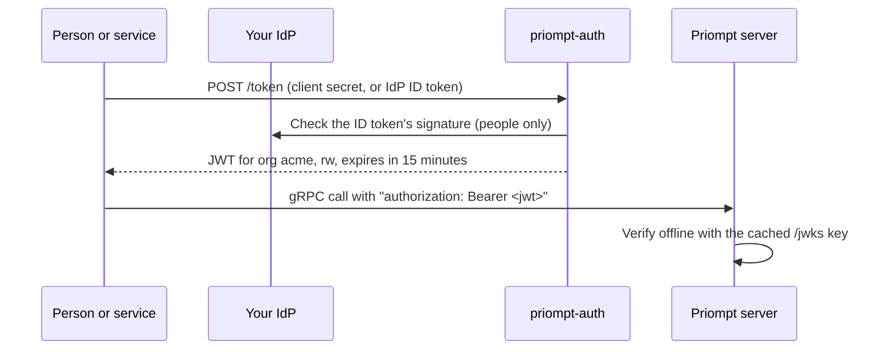

This guide sets up `priompt-auth`, a small token issuer that exchanges a credential you already trust for a **short-lived JWT**, a signed token that expires after 15 minutes by default. Service accounts such as `ci-bot` exchange a client ID and secret. People exchange an ID token from your identity provider (IdP), so access follows their IdP groups.

The Priompt server verifies each JWT offline against `priompt-auth`'s public key. If `priompt-auth` is down, tokens already issued keep working until they expire. The sequence below shows one exchange.



## Prerequisites

Before you begin, make sure you have:

- **`priompt-auth`**: run `go install github.com/priompt/auth/cmd/priompt-auth@latest` (Go 1.25 or later).
- **A Priompt server you can restart** with a new flag. See [Secure a server](../operations/security.md) for TLS and static tokens.
- **For SSO**: an OIDC application in your IdP that issues RS256 ID tokens with a `groups` claim, and the IdP's issuer URL.

## 1. Create a signing key

To create the key, run `init` in the directory `priompt-auth` will run from:

```sh
priompt-auth init
```

```text title="Output"
wrote auth.key (kid dacd1fc8)
next: priompt-auth gen-secret <client-id> [org] [rw], then priompt-auth serve
point the server at it: priompt serve -auth-jwks-url http://<this-host>:8444/jwks
```

`auth.key` is the Ed25519 private key that signs every token. Keep it secret and back it up.

## 2. Create a service account

To create a service account for CI with write access to `acme`:

1. Generate its secret:

   ```sh
   priompt-auth gen-secret ci-bot acme rw
   ```

   ```text title="Output"
   client_secret (give to the client, shown once):
     <secret>
   clients.txt line (safe to commit — it is a hash):
     ci-bot sha256:fb2e24c2b7c1976a536ee3ea1d73205b3eb8d997de175c2e68396d5bad36d3a1 acme rw
   ```

2. Store `<secret>` where the client reads it, such as a CI secret. `priompt-auth` keeps only its hash.
3. Add the printed line to `clients.txt`. Omit `rw` for a read-only account, and omit the org for an admin account that reaches every org.

## 3. Map IdP groups

Skip this step if you only need service accounts.

To map groups to access, create `groups.txt`. Each line is a group name, an optional org, and an optional `rw`. The first line that matches one of the person's groups wins, and a line without an org grants every org.

```text title="groups.txt"
# group          org    access
# The first matching line wins. No org means every org.
prompt-admins           rw
acme-authors     acme   rw
acme-readers     acme
```

:::warning Trailing comments need v0.7.3
From v0.7.3, a `#` after the first field starts a comment in `clients.txt`, `groups.txt`, and the server's tokens file, and a line with two org words is rejected at startup. In v0.7.2 and earlier, a trailing `# comment` is read as more fields: `prompt-admins rw # platform team` issues tokens scoped to the org `team`. On those versions, put comments on separate lines.
:::

## 4. Start priompt-auth

To start the issuer with both kinds of sign-in:

```sh
priompt-auth serve -clients-file clients.txt \
  -oidc-issuer https://idp.example.com -oidc-audience priompt -groups-file groups.txt
```

```text title="Output"
priompt-auth on :8444 (kid dacd1fc8, ttl 15m0s, clients 1, oidc true)
```

`-oidc-issuer` must match the `iss` claim of your ID tokens exactly. `priompt-auth` fetches the issuer's discovery document at startup and fails if it can't. Leave out the three OIDC flags for service accounts only. Change the token lifetime with `-ttl`. The [priompt-auth reference](../reference/priompt-auth.md) lists every flag and the claims in each token.

## 5. Point the server at it

To make the server trust these tokens, restart it with the JWKS URL:

```sh
priompt serve -auth-jwks-url http://localhost:8444/jwks
```

Requests without a valid token now fail:

```sh
priompt list
```

```text title="Output"
rpc error: code = Unauthenticated desc = invalid or missing token
```

Static tokens from `-tokens-file` keep working alongside JWTs, so you can move clients over one at a time.

## 6. Get a token as a service account

To call the server as `ci-bot`:

1. Exchange the client credentials for a token:

   ```sh
   curl -s -X POST localhost:8444/token \
     -d grant_type=client_credentials -d client_id=ci-bot -d client_secret=<secret>
   ```

   ```text title="Output"
   {"access_token":"<jwt>","token_type":"Bearer","expires_in":900}
   ```

2. Use the token as the bearer token. The CLI and `promptctl` read it from `PRIOMPT_TOKEN`:

   ```sh
   export PRIOMPT_TOKEN=<jwt>
   priompt publish -uri priompt://acme/support/agent -file v1.txt -slot org
   ```

   ```text title="Output"
   published priompt://acme/support/agent (1024719f5bbe) — subscribers notified
   ```

   The commit's author is `ci-bot`. A request for another org fails with `PermissionDenied desc = token not authorized for org "globex"`.

A wrong secret returns HTTP 401 with `{"error":"invalid_client"}`. Fetch a new token before the old one expires, for example at the start of each CI job.

## 7. Sign in a person through your IdP

`priompt-auth` doesn't host a login page. Your app or script gets an ID token from your IdP, then exchanges it.

To exchange an ID token:

```sh
curl -s -X POST localhost:8444/token -d grant_type=oidc -d id_token=<id-token>
```

For `ada@example.com` in the groups `staff` and `acme-authors`, the token's claims are `{"sub":"ada@example.com","org":"acme","rw":true,...}`. `priompt-auth` checks the signature against the IdP's published keys, then the issuer, expiry, and audience. The responses for failed checks are:

- **No mapped group**: HTTP 403, `{"error":"access_denied"}`.
- **Bad signature, wrong issuer or audience, or expired**: HTTP 401, `{"error":"invalid_grant"}`.

`priompt-auth` logs each decision as a JSON line on stderr, for example `"msg":"denied","grant":"oidc","sub":"bob@example.com","reason":"no group mapping"`.

:::tip Keycloak
Users created through the Keycloak admin API need an email, first name, and last name. Without them, direct grants fail with `Account is not fully set up`.
:::

## 8. Revoke access and rotate the key

To revoke access:

- **A service account**: delete its line from `clients.txt` and restart `priompt-auth`.
- **A person**: remove them from the IdP group. Their next exchange fails.

Tokens already issued stay valid until they expire, at most one `-ttl`.

To rotate the signing key, run `priompt-auth init -force` and restart `priompt-auth`. The server fetches the new key from `/jwks` when it first sees its key ID, at most once every 30 seconds, so it needs no restart. A running server keeps the old key too, so tokens signed with it work until they expire.

## Next steps

- [Gate prompt changes in CI](./ci.mdx): publish from GitHub Actions with a `ci-bot` token.
- [Orgs, tokens, and access](../concepts/access-control.md): how orgs scope every request.
- [priompt-auth reference](../reference/priompt-auth.md): every flag, file format, and token claim.
