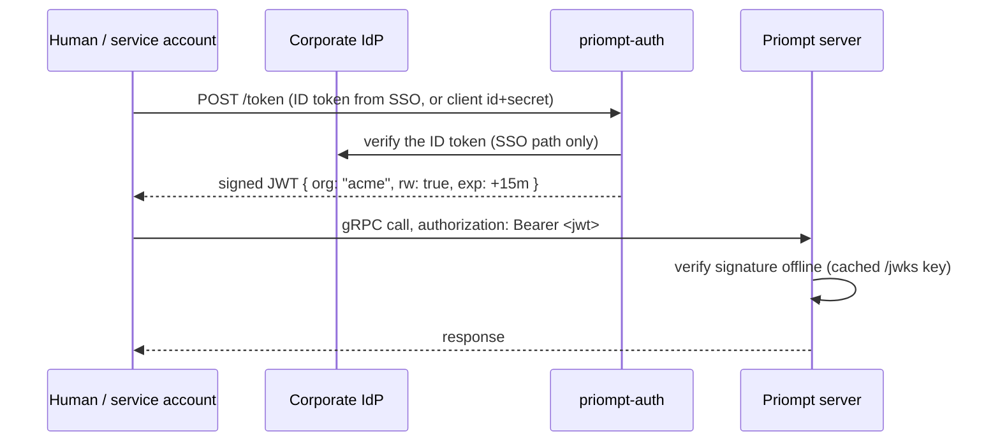

# SSO and service accounts (priompt-auth)

A static tokens file works until an enterprise asks *how do people log in with SSO, what happens when an employee leaves, and how do we rotate secrets?* `priompt-auth` answers all three. It exchanges a credential your company already trusts for a **short-lived signed JWT** that the Priompt server verifies **offline**.



- **Tokens last minutes, not months.** A leaked credential expires on its own.
- **Offboarding happens in the IdP.** Remove someone from the Okta group and their next token request fails.
- **No availability coupling.** If priompt-auth is down, already-issued tokens keep verifying until they expire.
- **Stateless.** No sessions and no database. It holds one signing key and the hashes of service-account secrets.

## Set it up

```sh
go build -o priompt-auth .        # in the auth repo; Go 1.25+

./priompt-auth init               # one-time: Ed25519 signing key -> auth.key

./priompt-auth gen-secret ci-bot acme rw
#   client_secret (give to the client, shown once):  <secret>
#   clients.txt line (safe to commit, it's a hash): ci-bot sha256:… acme rw

./priompt-auth serve -clients-file clients.txt          # :8444
priompt serve -auth-jwks-url http://localhost:8444/jwks # server now trusts it
```

## Service accounts (agents, CI)

These are OAuth2 client credentials:

```sh
curl -s -X POST localhost:8444/token \
  -d grant_type=client_credentials -d client_id=ci-bot -d client_secret=<secret>
# {"access_token":"eyJ…","token_type":"Bearer","expires_in":900}

PRIOMPT_TOKEN=eyJ… priompt list -prefix priompt://acme/ -addr localhost:8443
```

```text
# clients.txt: client_id sha256:<hex> [org] [rw]
ci-bot        sha256:d430dc…   acme   rw
dashboard     sha256:9f11ab…   acme
```

To revoke a client, delete its line and restart.

## SSO for humans (OIDC)

Priompt doesn't host a login page. Your IdP already has one, and priompt-auth only verifies its output (an RS256 ID token) against the IdP's published keys.

```sh
./priompt-auth serve -clients-file clients.txt \
  -oidc-issuer https://your-org.okta.com -oidc-audience priompt \
  -groups-file groups.txt
```

```text
# groups.txt: the first matching line wins; no org = admin (all orgs)
prompt-admins            rw     # platform team
acme-authors    acme     rw     # acme's prompt writers
acme-readers    acme            # read-only consumers
```

```sh
curl -s -X POST localhost:8444/token -d grant_type=oidc -d id_token=<IdP ID token>
```

priompt-auth checks the signature (against the issuer's JWKS), issuer, expiry, and audience, then maps the `groups` claim through `groups.txt`. A user in no mapped group gets `403 {"error":"access_denied"}`.

Tested end to end against Keycloak 26. If you use Keycloak, note that users created through the admin API need an email and first/last name set, or direct grants fail with `Account is not fully set up`.

## What a token contains

The token is a compact EdDSA (Ed25519) JWT. The claims contract lives once, in `priomptproto/claims`:

| Claim | Example | Meaning |
| --- | --- | --- |
| `sub` | `ci-bot`, `sujal@acme.com` | who it was issued to (recorded in audit logs and commit authorship) |
| `org` | `acme` (`""` = admin) | org scope |
| `rw` | `true` | may publish, branch, merge, or roll back |
| `exp` / `iat` | unix seconds | default TTL 15 minutes (`-ttl`) |
| `iss` | `priompt-auth` | issuer |

The server re-fetches `/jwks` (rate-limited) when it sees an unknown `kid`, so key rotation needs no server restart. To rotate, run `init -force` and restart priompt-auth. Outstanding tokens die within one TTL.

Static tokens keep working alongside JWTs, so you can migrate gradually. Flags are in the [priompt-auth reference](../reference/priompt-auth.md).
