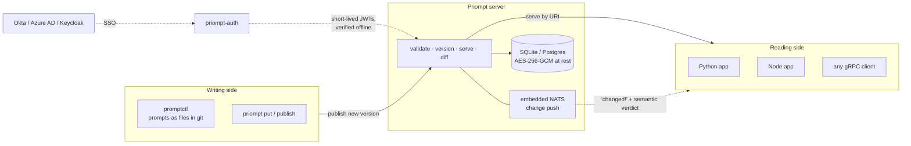

# What is Priompt?

**Priompt stores your AI prompts. It versions and validates them, serves each one by its address, and pushes changes live to every agent that uses them.**

If you've ever changed a prompt, broken an agent in production, and had no idea what the old prompt said, Priompt is for you. Code solved this long ago with Git: every change is recorded and you can always roll back. Priompt does that job for **prompts**, and adds two things Git can't do:

1. **A semantic diff.** It judges what an edit *means*. Is it a harmless rewording, or a structural change that rewires how the prompt behaves?
2. **Live distribution.** Agents hear about a change the moment it happens, *with that verdict attached*. They can hot-reload safe edits and hold risky ones for a human.

| Code has… | Prompts get… |
| --- | --- |
| A Git server | A Priompt server |
| A file path | A prompt address: `priompt://acme/onboarding/welcome` |
| Commits and branches | Commits and branches, per prompt |
| `git diff` | A **semantic diff**: did the *meaning* change, and how far did it spread? |
| Deploys | Live push notifications to every agent the moment a prompt changes |

You run the server, so your prompts stay in **your** infrastructure. Your agents can be written in any language, and they fetch prompts by address instead of hard-coding them.

## How it fits together

## The components

You only need the server. Everything else is opt-in.

| Component | Ships | What it does |
| --- | --- | --- |
| **priompt** | `priompt` server binary | The core. It stores, versions, validates, serves, and distributes prompts over gRPC, and embeds a NATS broker for change push. The same binary is also the ops CLI. |
| **promptctl** | `promptctl` binary | The authoring tool. Prompts live as files in a git repo, get validated on commit, are diffed semantically before shipping, and publish in one step. |
| **priompt-auth** | `priompt-auth` binary | Exchanges an SSO login or a service-account secret for a short-lived JWT, which the server verifies offline. |
| **Python SDK** | pip package (imports as `priompt`) | `get` / `list` / `diff` / `subscribe`, with an optional local cache and version pinning. |
| **JavaScript SDK** | npm package | `get` / `diff` / `publish` / `subscribe`. No codegen. |
| **Web UI** | SvelteKit app | Browse prompts, history, and diffs, and edit prompts in a browser. |
| **proto** | Go module `priomptproto` | The shared contracts: the gRPC API, JWT claims, validation rules, and the semantic diff engine. |
| **db-adapters** | Go module `priomptdb` | The storage engine as a library: SQLite and PostgreSQL, with optional encryption at rest. |

## Where to go next

- **Try it now:** [Quick start](./quickstart.mdx)
- **Install it for real:** [Linux](./installation/linux.mdx) · [macOS](./installation/macos.mdx) · [Windows](./installation/windows.mdx) · [Docker](./installation/docker.mdx)
- **Understand the model:** [Prompts](./concepts/prompts.md) · [Versioning](./concepts/versioning.md) · [Semantic diff](./concepts/semantic-diff.md)
- **See who it's for:** [Use cases](./guides/use-cases.md)

:::info Pre-release
Priompt works today: all 22 end-to-end suites pass. The Docker, PyPI, and npm names and the public Go module paths are still placeholders, and so is the license. Commands that use an unfinished name are marked on each page.
:::
