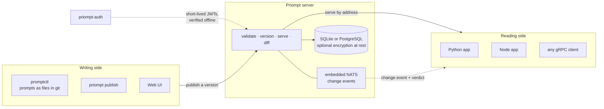

import Link from "@docusaurus/Link"

export const cards = [
  { title: "Quickstart", to: "/quickstart", body: "Run a server, fetch a prompt, and watch a change arrive in about ten minutes." },
  { title: "Install", to: "/installation", body: "Run the server with Docker, on Linux, macOS, or Windows, or build it from source." },
  { title: "Concepts", to: "/concepts/prompts", body: "Addresses, versioning, live updates, and the semantic diff." },
  { title: "Client SDKs", to: "/sdks", body: "Fetch prompts and subscribe to changes from Python, Node, or any gRPC language." },
  { title: "Web UI", to: "/guides/web-ui", body: "Browse, edit, and review prompts in a browser." },
  { title: "Self-host", to: "/operations/production-checklist", body: "Secure, back up, monitor, and scale a server." },
]

**Priompt is a prompt server: it stores, versions, and validates your AI prompts, serves each one by its address, and tells every agent the moment a prompt changes.**

A prompt edit can break an agent in production, and without history nobody can say what the old prompt was. Priompt gives prompts what git gives code: every change is a commit, and you can always roll back. It's for teams that run agents and want prompt changes to be reviewed, versioned, and delivered like code.

:::info Pre-release
Priompt is at v<Var name="version" />. The server image, both SDKs, and the Go modules are published under Apache-2.0. See [Status and roadmap](./roadmap.md) for what's done and what's missing.
:::

## Get started

  {cards.map((c) => (
    

      <Link to={c.to} className="card padding--md" style={{height: "100%", color: "inherit", textDecoration: "none"}}>
        <strong>{c.title}</strong>
        {c.body}
      </Link>
    

  ))}

## What Priompt adds

Priompt adds two things that git can't do for prompts:

- **Semantic diff**: Priompt scores what an edit means, from a harmless rewording to a structural change that rewires how the prompt behaves. See [Semantic diff](/concepts/semantic-diff).
- **Live distribution**: Agents hear about a change the moment it's published, with that verdict attached. They can reload safe edits on their own and hold risky ones for a person. See [Live updates](/concepts/live-updates).

| Code has | Prompts get |
| --- | --- |
| A git server | A Priompt server |
| A file path | A prompt address, such as `priompt://acme/onboarding/welcome` |
| Commits and branches | Commits and branches, per prompt |
| `git diff` | A semantic diff that says whether the meaning changed, and how far |
| Deploys | A change event to every subscribed agent |

You run the server, so your prompts stay in your infrastructure. Agents in any language fetch prompts by address instead of hard-coding them.

## How it fits together

The diagram shows who writes prompts, where Priompt stores them, and how agents read them and hear about changes.

See [How Priompt works](/concepts/architecture) for the request flow and the ports.

## Components

You only need the server. Everything else is optional.

| Component | What it does | Docs |
| --- | --- | --- |
| `priompt` | The server. It stores, versions, validates, and serves prompts over gRPC, and embeds a NATS broker for change events. The same binary is the ops CLI. Image: <Var name="dockerImage" />. | [Install](./installation/index.mdx), [CLI](/reference/cli) |
| `promptctl` | The authoring tool. Prompts live as files in a git repo, are validated and diffed before they ship, and publish in one step. | [Author prompts in git](/guides/promptctl) |
| `priompt-auth` | Exchanges an SSO login or a service-account secret for a short-lived JWT that the server verifies offline. | [SSO and service accounts](/guides/sso) |
| Python SDK | <Var name="pypiName" /> on PyPI, imported as `priompt_sdk`. Get, list, diff, and subscribe, with an optional local cache. | [Python SDK](/sdks/python) |
| Node SDK | <Var name="npmName" /> on npm. Get, diff, publish, and subscribe, with no code generation. | [JavaScript SDK](/sdks/javascript) |
| Web UI | A browser app to browse prompts, history, and diffs, and to edit prompts. | [Web UI overview](/guides/web-ui) |
| `proto` | The Go module `github.com/priompt/proto`: the gRPC API, JWT claims, validation rules, and the semantic diff engine. | [Change the contract](/contributing/proto) |
| `db-adapters` | The Go module `github.com/priompt/db-adapters`: the storage engine for SQLite and PostgreSQL. | [Storage engine](/contributing/db-adapters) |

The web UI shows a prompt with the slots Priompt detected in it:

## Next steps

- [Quickstart](./quickstart.mdx): run a server and watch a change arrive.
- [Use cases](./use-cases.md): see the problems teams solve with Priompt.
- [Install Priompt](./installation/index.mdx): pick Docker or a native service.
