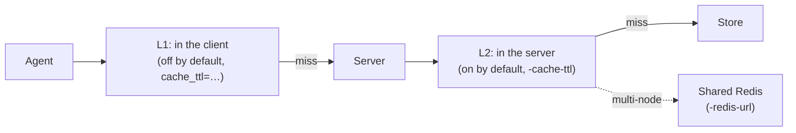

# Caching

There are two cache layers. Both are keyed by URI with TTL-bounded freshness, and only **validated** prompts are ever cached.



## L1: client

```python
client = PromptClient(host="localhost:8443", cache_ttl=30)
```

Repeat `get`s within the TTL never touch the network. Pair it with `subscribe()` for immediate updates, with the TTL as the fallback.

## L2: server

This layer is in-process by default (`-cache-ttl 30s`; `0` turns it off). For multiple nodes, share one Redis:

```sh
priompt serve -redis-url redis://localhost:6379/0 -cache-ttl 60s
```

Keys look like `priompt:cache:<uri>`. Publishing or rolling back **deletes** the key (write-through invalidation). If that invalidation fails, the publish returns `UNAVAILABLE` rather than letting nodes serve stale content.

Every cache read is best-effort: a Redis hiccup becomes a cache miss, never a serving error. When encryption at rest is on, Redis values are sealed with the same key, because Redis snapshots to disk too.
