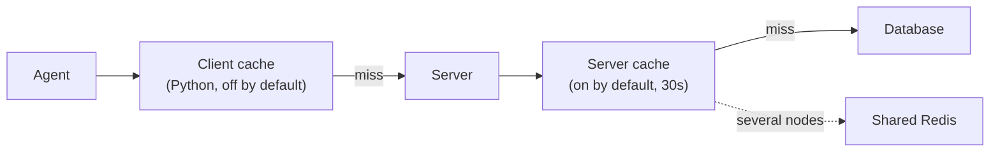

Priompt caches prompts in two places: in the Python client, so repeated fetches skip the network, and in the server, so repeated fetches skip the database. This guide sets up both, and shares the server cache across nodes with Redis. Both caches hold only prompts the server has validated, and both are keyed by prompt address.

The diagram shows where each cache sits on the path of a fetch.



## Prerequisites

Before you begin, make sure you have:

- **A running server**: see the [Quickstart](../quickstart.mdx).
- **For the client cache**: the [Python SDK](../sdks/python.mdx). The JavaScript SDK has no client cache.
- **For a shared cache**: a Redis server that every node can reach.

## Turn on the client cache

Pass `cache_ttl`, in seconds, to `PromptClient`. Within that time, `get()` and `list()` return the stored result without calling the server.

```python
import time
from priompt_sdk import PromptClient

uri = "priompt://acme/onboarding/welcome"

for ttl in (0, 30):
    client = PromptClient(host="localhost:8443", cache_ttl=ttl)
    client.get(uri)  # warm up the connection
    start = time.perf_counter()
    for _ in range(1000):
        client.get(uri)
    ms = (time.perf_counter() - start) * 1000
    print(f"cache_ttl={ttl}: 1,000 gets in {ms:.1f} ms")
    client.close()
```

```text title="Output"
cache_ttl=0: 1,000 gets in 525.8 ms
cache_ttl=30: 1,000 gets in 0.2 ms
```

These numbers come from one laptop running the client and a single SQLite server over loopback. Over a real network, each uncached fetch costs at least one round trip. See [Testing](../contributing/testing.md) for how Priompt is benchmarked.

How the client cache behaves:

- **A change shows up within `cache_ttl` seconds.** Until then, `get()` returns the cached version.
- **`subscribe()` refreshes it at once.** When a change event arrives, the client drops the cached prompt and fetches the new version. Pair a long `cache_ttl` with `subscribe()` to get both speed and fast updates. See [Hot-reload prompts safely](../guides/hot-reload.mdx).
- **Pinned fetches skip it.** `get(uri, ref=...)` always calls the server.
- **`list()` results are cached separately**, and `subscribe()` doesn't refresh them. A new prompt under a prefix appears after `cache_ttl` seconds.

## Tune the server cache

Each node keeps fetched prompts in memory for `-cache-ttl`, 30 seconds by default. A publish or a rollback on that node clears the prompt's entry, so a single node never serves a stale version.

```sh
priompt serve -cache-ttl 60s   # keep entries for a minute
priompt serve -cache-ttl 0     # turn the server cache off
```

With several nodes and in-memory caches, a node only clears its own cache. In a test with two nodes on one database and `-cache-ttl 10s`, node B kept serving the old version after a publish on node A until its entry expired:

```text title="Output"
B before: Hi {name}, welcome to {org}!
A after:  Hi {name}, welcome back to {org}!
B after:  Hi {name}, welcome to {org}!
B +11s:   Hi {name}, welcome back to {org}!
```

To avoid that, share one cache between nodes.

## Share the cache with Redis

To share the server cache:

1. Start every node with the same Redis URL. You can also set it in `PRIOMPT_REDIS_URL`:

   ```sh
   priompt serve -db postgres://priompt:<password>@db:5432/prompts -redis-url redis://cache:6379/0 -cache-ttl 60s
   ```

   The startup line shows `cache=redis`.

2. Fetch a prompt, then check the key in Redis:

   ```sh
   redis-cli keys '*'
   ```

   ```text title="Output"
   priompt:cache:priompt://acme/onboarding/welcome
   ```

Each key is `priompt:cache:` followed by the prompt's address, and it expires after `-cache-ttl`. A publish, a rollback, or a merge into `main` deletes the key, so every node serves the new version on its next fetch.

How the shared cache handles failures:

- **Reads fall back to the database.** If Redis is down, a fetch is a cache miss, not an error.
- **Writes fail loudly.** If Redis is down, a publish stores the new version but returns `Unavailable: the change is stored but the cache could not be cleared; retry so readers see it`. Retry after Redis is back. Publishing the same content again clears the cache.
- **Values are sealed.** With [encryption at rest](./storage.md#turn-on-encryption-at-rest) on, Redis values are encrypted with the same key, because Redis also writes to disk.

## Next steps

- [Scale to multiple nodes](./scaling.md): share the database, the cache, and change events.
- [Live updates](../concepts/live-updates.md): how change events and cache expiry work together.
- [Hot-reload prompts safely](../guides/hot-reload.mdx): act on change events in an agent.
- [Configuration](../reference/configuration.md): every cache flag and environment variable.
