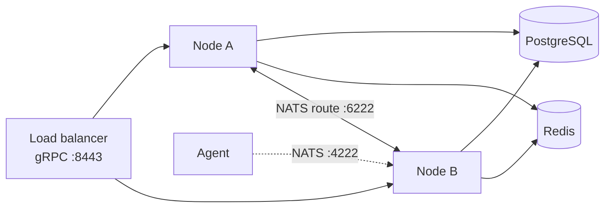

This guide runs several identical Priompt nodes behind a load balancer. Any node can serve any request once the nodes share three things: the database, the server cache, and the broker that carries change events.

A single SQLite node is a floor, not a ceiling. On one laptop it handled about 192 sequential writes per second and about 6,350 reads per second from 32 threads (see [Testing](../contributing/testing.md) for the conditions). Add nodes when you need more throughput or no single point of failure.

The diagram shows what each node shares.



| Shared | How |
| --- | --- |
| Database | The same `-db postgres://...` on every node. |
| Server cache | The same `-redis-url redis://...` on every node. |
| Change events | Each node's embedded broker joins a cluster with `-nats-routes`. |

## Prerequisites

Before you begin, make sure you have:

- **PostgreSQL**: move existing data first. See [Migrate from SQLite to PostgreSQL](./storage.md#migrate-from-sqlite-to-postgresql).
- **Redis**: reachable from every node.
- **A load balancer that speaks HTTP/2**: gRPC needs either a TCP (layer 4) balancer or a layer 7 balancer with gRPC support, such as Envoy, nginx with `grpc_pass`, or a cloud gRPC load balancer.
- **A broker token and a cluster secret**: two values from `priompt gen-token`.

## Share the database and the cache

Start every node with the same database and cache:

```sh
priompt serve -db postgres://priompt:<password>@db:5432/prompts -redis-url redis://cache:6379/0
```

With a shared cache, a publish on one node clears the entry for every node. Without it, other nodes can serve the old version until their own cache expires. See [Caching](./caching.md).

## Cluster the brokers

Each node runs its own NATS broker. An agent subscribes to one of them, so without a cluster it never hears about a publish that lands on another node. In a cluster of N unconnected nodes, an agent misses (N-1)/N of all changes.

To cluster the brokers:

1. Set the broker token and the cluster secret on every node:

   ```sh
   export PRIOMPT_NATS_TOKEN=<nats-token>
   export PRIOMPT_NATS_CLUSTER_SECRET=<cluster-secret>
   ```

2. Start node A with a cluster listener and a route to node B:

   ```sh
   priompt serve -db postgres://priompt:<password>@db:5432/prompts -redis-url redis://cache:6379/0 \
     -nats-addr 0.0.0.0:4222 \
     -nats-cluster-addr 0.0.0.0:6222 -nats-routes nats://node-b:6222
   ```

3. Start node B the same way, with `-nats-routes nats://node-a:6222`. For more nodes, list every peer, separated by commas.

Without a cluster secret, the server refuses a cluster listener on a non-loopback address:

```text title="Output"
-nats-cluster-addr 0.0.0.0:6222 is not loopback: set -nats-cluster-secret (or PRIOMPT_NATS_CLUSTER_SECRET) so cluster peers must authenticate. Keep this port on a trusted network either way — it also accepts client connections
```

:::warning Keep the cluster port private
The cluster secret authenticates peers, but the cluster port also accepts ordinary client connections from anyone with the broker token. Never expose port `6222` outside your private network.
:::

## Verify the cluster

To check that events cross nodes:

1. Watch a prompt through node B's broker:

   ```sh
   priompt watch -uri priompt://acme/onboarding/welcome -nats-url nats://<api-token>@node-b:4222
   ```

2. In another terminal, publish through node A:

   ```sh
   priompt publish -addr node-a:8443 -uri priompt://acme/onboarding/welcome -file welcome.txt -slot name -slot org
   ```

   The watcher on node B prints the change:

   ```text title="Output"
   2026/10/18 10:19:23 watching priompt://acme/onboarding/welcome on nats://***@node-b:4222
   2026/10/18 10:19:25 priompt://acme/onboarding/welcome updated -> 4146f71b692cee44f267330189c8d26fd3ac115c10b351e69ffb0939d122a4e3 [structural]
   ```

3. Fetch the prompt through node B and check that it serves the new version at once.

If the watcher prints nothing, check that each node's `-nats-routes` names the other nodes' cluster addresses, and that port `6222` is open between them.

## Put a load balancer in front

What to know when you balance traffic across nodes:

- **Nodes keep no state of their own.** Everything lives in PostgreSQL and Redis, so any node can take any request.
- **Concurrent publishes are safe.** Each commit moves the branch with a compare-and-swap in the database. If two nodes publish to the same prompt at the same moment, one wins and the other fails with `Aborted: the branch moved while this write was in flight; re-read and retry`.
- **Agents can subscribe to any node's broker.** Expose port `4222` through a TCP balancer, or point each agent at one node.
- **Rate limits apply per node.** The cluster-wide limit is the per-node rate times the number of nodes. See [Monitoring and rate limits](./monitoring.md).

## Next steps

- [Production checklist](./production-checklist.md): every setting to check before go-live.
- [Storage and backups](./storage.md): back up the shared database.
- [Secure a server](./security.md): the broker token and TLS on each node.
- [Live updates](../concepts/live-updates.md): how change events reach agents.
