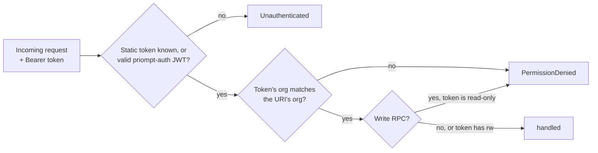

# Security: tokens, orgs, TLS



:::danger Open by default
When no token is configured, the server accepts every request. That's meant for local development only.
:::

## First run

```sh
priompt init                              # mints an admin write token into tokens.txt
priompt serve -tokens-file tokens.txt
export PRIOMPT_URL=priompt://<token>@localhost:8443
```

`init` refuses to overwrite an existing tokens file unless you pass `-force`.

## Three ways to authenticate

All three can run on one server at the same time.

1. **`PRIOMPT_TOKEN`:** a single admin write key.
2. **`-tokens-file`:** multiple keys with org scoping, write grants, and expiry.
3. **`-auth-jwks-url`:** short-lived JWTs from [priompt-auth](../guides/sso.md), for SSO and service accounts.

Every request sends `authorization: Bearer <token>`. Tokens are compared in constant time.

## The tokens file

```text
# tokens.txt: token [org] [expiry] [rw]
s3cr3t-admin                       # admin, read-only: every org, never expires
admin-rw                    rw     # admin, may write
acme-read     acme                 # scoped read-only: only priompt://acme/…
acme-author   acme         rw      # scoped, may write
rotating-key  acme  2026-12-31 rw  # scoped + expires (date or RFC3339) + write
```

- A bare token is **admin** (all orgs). A token with an org can only reach `priompt://org/…`.
- **Write access is opt-in.** Only `rw` lines may publish, branch, merge, or roll back.
- The fields after the token are matched by keyword, so they can appear in any order.
- A past expiry is rejected with `Unauthenticated`.
- **To rotate a key, overlap it:** issue the new key, give the old one a near-future expiry, and drop it once it lapses. `priompt gen-token` mints a random token.

Authorization is org-prefix scoping plus a read/write grant. Per-prompt rules aren't modeled.

## TLS and mTLS

```sh
# TLS
priompt serve -tls-cert server.pem -tls-key server.key

# mTLS: connections without a cert signed by ca.pem are refused at the TLS layer, before auth
priompt serve -tls-cert server.pem -tls-key server.key -client-ca ca.pem
```

Clients:

```sh
priompt list -tls -ca-cert ca.pem                                        # TLS
priompt list -tls -ca-cert ca.pem -cert client.pem -key client.key       # mTLS
```

```python
PromptClient(host="prompts.internal:8443", tls=True, ca_cert="ca.pem",
             client_cert="client.pem", client_key="client.key")
```

A self-signed setup for testing with openssl:

```sh
openssl req -x509 -newkey rsa:2048 -nodes -days 365 -keyout ca.key -out ca.pem -subj "/CN=priompt-ca"
openssl req -newkey rsa:2048 -nodes -keyout server.key -out server.csr -subj "/CN=localhost"
openssl x509 -req -in server.csr -CA ca.pem -CAkey ca.key -CAcreateserial -days 365 -out server.pem \
  -extfile <(printf "subjectAltName=DNS:localhost,IP:127.0.0.1")
```

## Encryption at rest

Set `PRIOMPT_ENCRYPTION_KEY` (base64 of 32 bytes) and prompt content is encrypted with AES-256-GCM before it reaches the disk. The Redis cache is sealed with the same key. See [Storage](./storage.md#encryption-at-rest).

## Hardening checklist

- [ ] Tokens configured (`priompt init`). The server isn't open.
- [ ] `PRIOMPT_SEED=false`
- [ ] TLS on the gRPC port, or mTLS for service-to-service
- [ ] `PRIOMPT_NATS_TOKEN` set if 4222 is reachable. Never expose the NATS cluster port publicly.
- [ ] `:2112` metrics bound to an internal interface
- [ ] `PRIOMPT_ENCRYPTION_KEY` set, and the key backed up separately from database backups
- [ ] `-rate-limit` set if many teams share the server
- [ ] Tokens file and env files readable only by the service account
