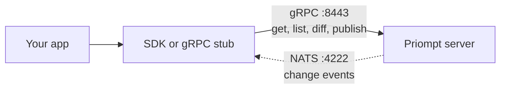

A Priompt SDK is the client library your app uses to fetch prompts from a Priompt server by address and to hear when they change. Priompt has SDKs for Python and Node, and any other language can call the same gRPC API directly.

## How a client talks to the server

Each client makes two connections. The diagram shows what goes over each one.



- **gRPC on port 8443** carries every request: fetch, list, diff, publish, and the versioning RPCs.
- **NATS on port 4222** carries change events to subscribers. Only `subscribe()` uses it.

## Feature matrix

The SDKs wrap the calls an app makes most. The gRPC API has every operation, and both SDK packages include the stubs or the `.proto` file to reach it.

| Feature | Python | JavaScript | gRPC |
| --- | --- | --- | --- |
| Fetch the served version | `get(uri)` | `get(uri)` | `GetPrompt` |
| Pin a branch or commit | `get(uri, ref=...)` | `get(uri, ref)` | `GetPrompt` with `ref` |
| List prompts under a prefix | `list(prefix)` | No | `ListPrompts` |
| Semantic diff of a draft | `diff(uri, new_template)` | `diff(uri, newTemplate)` | `DiffPrompt` |
| Publish to `main` | No | `publish(uri, template, slots)` | `PublishPrompt` |
| Subscribe to changes | `subscribe(uri, on_change)` | `subscribe(uri, onChange)` | Any NATS client |
| History, branches, merge, rollback | Stubs in `priompt_sdk.v1` | Stubs from the shipped `.proto` | `History`, `CreateBranch`, `MergeBranch`, `SetBranch` |
| Local cache | `cache_ttl=` | No | No |
| TLS and mTLS | Yes | Yes | Yes |
| Connection URL (`PRIOMPT_URL`) | Yes | Yes | No |

"No" means the SDK doesn't wrap the call. You can still make it through the stubs.

## Install a client

<Tabs groupId="lang">
<TabItem value="py" label="Python" default>

<Cmd lang="sh">{`pip install {{pypiName}}`}</Cmd>

Requires Python 3.9 or later. See [Python SDK](./python.mdx).

</TabItem>
<TabItem value="js" label="JavaScript">

<Cmd lang="sh">{`npm i {{npmName}}`}</Cmd>

Requires Node 20 or later. See [JavaScript SDK](./javascript.mdx).

</TabItem>
<TabItem value="grpc" label="gRPC">

Generate a client from `prompt.proto` with your language's gRPC tooling. See [Use the gRPC API from any language](./other-languages.mdx).

</TabItem>
</Tabs>

## Connection settings

Both SDKs read the same connection URL from the `PRIOMPT_URL` environment variable:

```sh
export PRIOMPT_URL=priompt://<token>@prompts.example.com:8443
```

Replace `<token>` with a token the server accepts, or leave out `<token>@` for a server without authentication. An explicit host or token passed in code wins over the URL. The broker for change events takes its own URL and its own token, because the broker credential is separate from the gRPC token.

## Next steps

- [Python SDK](./python.mdx): install, fetch, list, diff, and subscribe from Python.
- [JavaScript SDK](./javascript.mdx): install, fetch, publish, diff, and subscribe from Node.
- [Use the gRPC API from any language](./other-languages.mdx): generate a client for Go, Java, or another language.
- [Hot-reload prompts safely](../guides/hot-reload.mdx): act on change events in a running agent.
